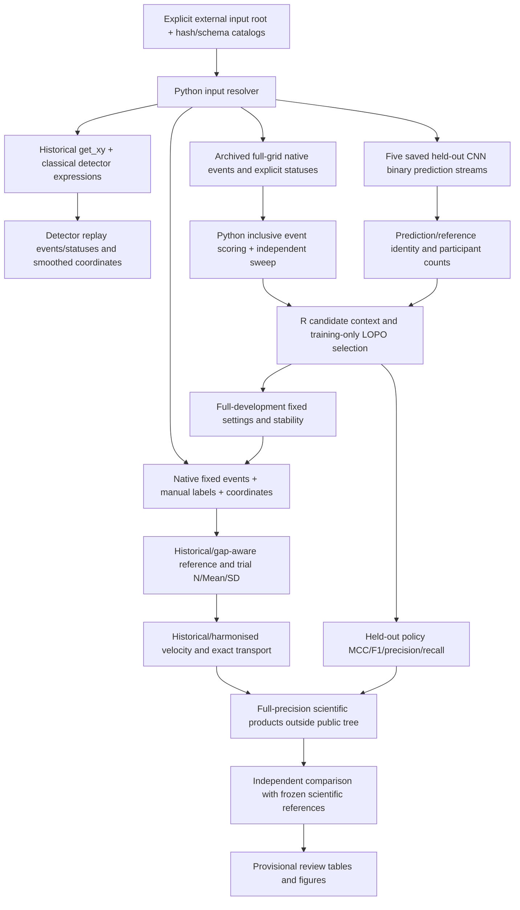

# Scientific flow and producer map

The preprocessing/detector replay checks unchanged historical code against archived native results. Its tested small scope is distinct from full-grid **scoring**, which reads every archived configuration/trial result. `--detector-scope full` is the expensive detector replay path; `archived` explicitly reuses native outputs. No replay mode runs CNN or refits I-HMM. Full exact transport and representative exact transport use the same supports/solver; a representative scope emits only prespecified comparison IDs and must not be reported as all 504 comparisons.

| Products | Executable producer | Scientific inputs |
|---|---|---|
| Input paths, source hashes and relocated native pointers | `python/scientific_inputs.py` | `config/scientific_inputs.csv`, authorised input root |
| Smoothed coordinates; replayed classical events/statuses | `R/detector_replay.R` calling pinned external `get_xy`/detector expressions | Raw/archived 30-Hz gaze, grid, explicit native reference events/statuses |
| Per-trial full-grid confusion counts, Part 1 landscapes, CNN participant counts | `python/recompute_counts.py`; original extracted `scientific_metrics.py` | Native intervals, three-rate availability ledgers, Original mask, held-out predictions |
| Joint LOPO configurations, candidate/training supports, held-out sample metrics | `R/executable/part2/{inputs,selection,evaluation}.R` | Per-trial candidate counts, 20-participant roster, reference rows |
| Development fixed configurations, stability and interpretation | `R/executable/part2b/{workflow,calculate}.R` | Candidate context and newly computed LOPO choices |
| Native/reference events and explicit call roster | `python/native_inputs.py` | Fixed-source pointers, manual labels, native event/status exports, coordinates/blockers |
| Event trial/distribution summaries and reference diagnostics | `R/executable/part3/events.R` | Newly reconstructed event/call/coordinate tables; original R reference extract |
| Per-event and aggregate velocity/missingness | `R/executable/part3/velocities.R` | New native events, raw coordinates, timestamps/components, historical smoothing |
| Exact raw distances, similarities, support/scaling ledgers | `R/executable/part3/transport.R` | New trial N/Mean/SD; pinned T4transport 0.1.8 and wrapper |
| Recomputed event curve source data and distribution plots | `R/executable/part3/figures.R` (full scope) | New native events, velocities and transport support ledger |
| Descriptive duration/reference sensitivities | `python/event_sensitivities.py` (full scope) | Newly computed transport outputs and period diagnostics |
| Independent scientific checks | `python/independent_selection.py`, `independent_events_transport.py`, `independent_transport.py`, `compare_scientific.py` | Actual run outputs; immutable scientific inputs and frozen references |
| Existing compact review tables/figures | `R/review.R`, `R/part1_figures.R` | Verified frozen aggregate data; output CSV names match producer fields |

The public compact-review layer and private scientific-recompute layer remain distinct. Existing review artifacts are preserved. New scientific output hashes/statuses are written under the configured private output root. A passed subset comparison does not authorise replacing the whole frozen review bundle. Full regeneration from a new scientific run requires its full corresponding validation gate; do not substitute a representative transport subset into complete figures.

`config/executable_code_manifest.json` records exact source lineage, extraction/adaptation scope and hashes. Environment/library lookup and computation-subset controls are explicit; scientific formulas and original function bodies remain inspectable. Original source/workflow files and previous public validation records remain available separately.
